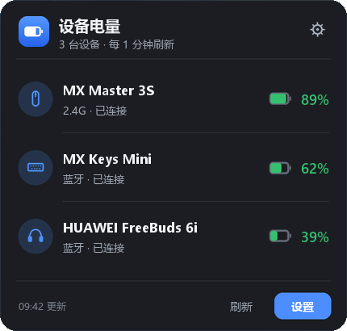
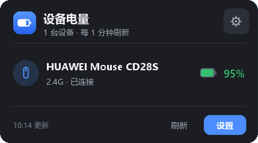

# 电量助手 · TrayBattery

[](https://github.com/SodagreenPromise/TrayBattery/actions/workflows/tests.yml)
[](LICENSE)
[](requirements.txt)
[](#运行)

在 Windows 任务栏实时显示**蓝牙 / 2.4G 接收器连接的鼠标、键盘、耳机电量**。默认只显示鼠标，可在设置里勾选其它设备。

纯 Python + ctypes + Pillow 实现，不装驱动、不依赖厂商管家：一个后台线程按间隔轮询，常驻内存约 45 MB，空闲 CPU 接近 0。

> A tiny Windows tray app that shows battery levels of Bluetooth and 2.4 GHz mice, keyboards and headsets — pure Python, no drivers, no vendor software.



## 功能

- **托盘图标**：电池图标随电量变色（绿 / 橙 / 红），可轮播或固定显示某台设备；悬停显示各设备电量。
- **电量面板**：左键托盘图标开合；显示设备名、连接方式、状态、百分比与电池图标；底部显示更新时间，可「刷新」「设置」。
- **任务栏悬浮条**（可选）：贴在工作区右下角常驻显示已选设备，可拖动并记住位置，点击打开面板。
- **设置窗口**：勾选显示设备、刷新间隔（30 秒 / 1 / 2 / 5 分钟）、托盘图标模式、悬浮条开关、低电量提醒、开机自启、主题（跟随系统 / 浅色 / 深色）。
- **状态区分**：`已连接` / `未连接` / `设备未提供电量接口` / `厂商私有协议，暂未适配` / `读取失败` 分别用不同文案与配色；设备离线时保留上次读到的电量。
- **通用 HID 电池**：按标准 usage 匹配电量字段（`0x06/0x20`、`0x0D/0x3B`、`0x85` 电池系统页），Feature 与 Input 报告都支持，`0–100` 与 `0–255` 量纲自动归一化。
- **已适配的私有协议**：华为 / 荣耀（真机验证）、罗技 HID++ 2.0、Compx 方案（ATK / VXE / VGN / 达尔优 / G-Wolves 等）、雷蛇。
- **低电量提醒**：低于 15%（`config.json` 的 `alert_threshold` 可改）时弹一次气泡通知。
- **自适应**：跟随系统深浅色，Per-Monitor V2 DPI（125% / 150%），多显示器工作区，分辨率变化后自动归位。
- **健壮性**：单实例运行，重复启动会唤起已有窗口；资源管理器重启后自动重新添加托盘图标。

任务栏悬浮条（可拖动、点击开合面板）：


真实设备（华为接收器，2.4G）：



## 运行

要求：Windows 10 / 11，Python 3.10+，Pillow。

```bash
pip install -r requirements.txt
pythonw TrayBattery.pyw
```

也可以直接双击 `TrayBattery.pyw`（`.pyw` 关联到 pythonw，不弹控制台窗口）。

命令行参数：

| 参数 | 说明 |
| --- | --- |
| `--panel` | 打开电量面板（已有实例时转发给已运行的实例） |
| `--settings` | 打开设置（同样会转发给已运行的实例） |
| `--demo` | 使用演示设备（MX Master 3S / MX Keys Mini / FreeBuds 6i），无需真实设备即可预览界面 |
| `--quit` | 关闭已运行的实例 |

程序只允许一个实例：再次启动不会创建第二份托盘图标，而是唤起已有窗口。

## 首次使用

1. 启动后托盘出现电池图标，默认只勾选**鼠标**。
2. 左键图标查看电量；右键图标打开菜单：

   - 打开电量面板
   - 设备勾选列表（直接勾选要显示的设备）
   - 立即刷新 / 暂停自动刷新
   - 显示任务栏悬浮条
   - 设置…
   - 开机自动启动
   - 退出

3. Windows 11 默认把新图标放进**溢出区**（任务栏的 `^`）。点开溢出区，把电池图标拖到任务栏上即可常驻；也可以在「设置 → 个性化 → 任务栏 → 其他系统托盘图标」中打开。

## 电量从哪来

| 设备类型 | 数据来源 | 说明 |
| --- | --- | --- |
| 蓝牙耳机 / 音箱 / 手柄 / 部分键鼠 | Windows 蓝牙电量属性（`DEVPKEY_Bluetooth_Battery`） | 需要设备自身通过 HFP/BLE 上报，绝大多数蓝牙耳机支持 |
| 罗技无线键鼠（2.4G 接收器） | 罗技 HID++ 2.0（`0x1004` / `0x1000` / `0x1001`） | 直接和接收器通信，不需要 Logitech Options；遍历接收器 1–6 号设备位 |
| 华为 / 荣耀无线鼠标（星闪或 2.4G 接收器） | 厂商私有 HID 通道（Usage Page `0xFFB3`，数据项 `0x1A`） | 见下方「华为接收器电量协议」，不需要官方驱动；已在真机验证 |
| Compx 方案无线鼠标（ATK / VXE / VGN / 达尔优 / G-Wolves / Zaopin / Scyrox 等） | Compx 公版协议：`0xFF02` 17 字节 / `0xFF05` 64 字节 | 只读查询，按 VID + 鼠标集合命中才执行；协议取自公开开源实现，本机无对应设备未实机验证 |
| 雷蛇无线鼠标（Viper / DeathAdder / Basilisk / Naga / Cobra / Pro Click 等） | 90 字节 Feature Report，命令类 `0x02` / 命令 `0x07` | 按 OpenRazer 公开协议实现，`0x1F` 事务号家族；未实机验证 |
| 标准 HID 外设 | 电量 usage：`0x06/0x20`、`0x0D/0x3B`、`0x85` 电池系统页 | 同时支持 Feature 与 Input 报告；数值按 `LogicalMin/Max` 归一化 |
| 其他品牌的 2.4G 接收器键鼠 | 各家私有协议（未适配） | 显示「厂商私有协议，暂未适配」，可按下方流程补充；报文格式需逐家逆向 |
| 有线 USB 键鼠、无电量上报的设备 | — | 显示「设备未提供电量接口」 |
| 系统里已断开 / 未连接的设备 | 上一次成功读取的值 | 显示「离线」，并标注上次电量 |

> 实现细节：鼠标 / 键盘 / 触控板这类顶层集合会被 Windows 独占，带读写权限 `CreateFileW` 会返回拒绝访问。
> 程序在失败时改用 `dwDesiredAccess = 0` 重新打开，此时仍可读属性与 Feature Report——这是很多标准 HID 电池设备能被读到的前提。

### 华为接收器电量协议

以 `HUAWEI Mouse CD28S`（VID `12D1`、PID `10DB`）为例，接收器在 USB 上暴露 5 个厂商自定义 HID 集合（`0xFFB0`…`0xFFB4`），
其中 `0xFFB3` 是状态/控制通道（64 字节输入 + 64 字节输出，无 Feature Report）。报文首字节固定为 `0x05`：

```
查询电量（主机 → 接收器，64 字节）
  05 1E 00 1A  00 00 ...
              └─ 数据项 0x1A = 电量
应答（接收器 → 主机）
  05 20 00 1A  06  00 00 00 5F 00 00 ...
              └─ 长度 6 └─ 负载[3]=0x5F(95%) 负载[4]=状态
```

状态位：`0` 放电、`1` 充电中、`2` 已充满（统计官方软件日志 300 余次读数得出，`2` 只在 100% 出现）。
另有 `05 00 00 AA …` 心跳帧由接收器每 7 秒主动推送，`05 00 00 F9` 可取型号与固件（ASCII，如 `CD28S 1.0.0.97`）。

因为每次查询都会把无线链路叫醒，程序对这类设备做了 **60 秒缓存**，手动「刷新」时才强制重查。

### 给新的接收器型号加支持

私有协议没有公开文档，做法是「先看通道，再看官方软件怎么问」。仓库里带了几个只读/半只读工具：

```bash
# 0) 一键诊断：接口清单、标准电池字段命中情况、已知私有协议结果
python tools/probe_battery.py
python tools/probe_battery.py 373b        # 只看某个 VID

# 1) 看这个 VID 暴露了哪些 HID 集合、有没有 0xFF00+ 私有页、有没有 Feature Report
python tools/probe_hid.py 046d

# 2) 被动监听 20 秒（不发送任何数据），看哪个通道在主动推帧
python tools/listen_hid.py 20 046d

# 3) 只读探测：试 GetInputReport / GetFeature，确认能否直接取到状态
python tools/probe_read.py 046d

# 4) 按第 3 步得到的通道发一帧并读应答（换掉 FFB3 与报文）
python tools/probe_cmd.py send FFB3 "05 1E 00 1A" --repeat 1
```

如果设备有官方驱动/管家软件，先去看它的通信日志，往往能直接读到协议语义——本项目的华为支持就是这么来的：
`%LOCALAPPDATA%\HUAWEI GoPlay\NeoUsb.log` 里写着 `Dangle model write command 1a` 与 `get power value 95`。

拿到报文后，在 `app/providers.py` 里照 `scan_compx()` / `scan_razer()` 的写法加一个 `scan_xxx()`，
在 `discover()` 的 `vendor_battery` 里合入即可（返回 `{容器 ID: (电量, 是否充电)}`）。

### 已知的公开协议（可直接抄）

**Compx / Nordic 52840**（ATK、VXE、VGN、达尔优、G-Wolves、Zaopin、Scyrox 等共用）：

```
写  08 04 00 00 00 00 00 00 00 00 00 00 00 00 00 00 49     ← 17 字节，整帧和为 0x55
读  08 04 00 00 00 02 23 00 0e 94 00 00 00 00 00 00 82
           └状态    └35%  └有线标志  └ 3732 mV
```

**Nordic 54L15**（ATK Zero 等新款）：`08 7D 72 02 00 01 07 01`，64 字节；回复 `[1]=0x72`、`[5]=0x07`、电量在 `[7]`。

**雷蛇**：Feature Report 90 字节，`00 1F 00 00 00 02 07 80` + 80 字节数据 + XOR 校验 + 0，
回复第 `[9]` 字节为 0–255 的电量（含 report id 时是 `[10]`），无线鼠标需等待约 300 ms 才有应答。

**罗技**：HID++ 2.0，`0x1004` 统一电量 → `0x1000` 电量状态 → `0x1001` 电压估算。

协议来源：`Fan4Metal/mouse_tray`、`yszyszysz233/2.4G-battery-viewer`、OpenRazer。若要新增型号，
多数情况只需把 VID/PID 加进对应列表（`COMPX_VIDS` / `RAZER_PIDS`），报文本身不用改。

## 测试

```bash
# 单元测试：数据模型、配置读写、协议工具函数、绘制
python -m unittest discover -s tests -v

# 功能冒烟：用 demo 数据启动完整应用，操作托盘/面板/悬浮条/设置后退出
python tools/smoke.py
```

冒烟测试会把配置重定向到临时目录、跳过注册表操作，不会影响正在使用的配置；运行时会短暂弹出窗口（约 5 秒）。
GitHub Actions 会在 Windows + Python 3.10 / 3.12 上跑单元测试（见 `.github/workflows/tests.yml`）。

当前覆盖：24 个单元测试 + 41 项界面交互检查，包含首次启动默认只显示鼠标、面板定位不越界且不压住悬浮条、
设备增减后悬浮条宽度变化、设置滚动与点击、主题切换、暂停/恢复刷新等。

## 配置与日志

- 配置：`%APPDATA%\TrayBattery\config.json`（原子写入，损坏时回落到默认值）
- 日志：`%APPDATA%\TrayBattery\app.log`（异常堆栈会写在这里，便于排查）

删除配置目录即可恢复出厂状态。

## 常见问题

**面板显示「1 台设备」但只有鼠标？**
默认只显示鼠标。打开设置勾选其它设备，或在托盘右键菜单里直接勾选。

**耳机一直显示「离线」？**
设备在系统里没有连接。连上后等一轮刷新（或点「立即刷新」）即可。若系统蓝牙里显示已连接但仍离线，检查是否被其它设备（手机）抢占连接。

**电量不更新？**
先确认没有「暂停自动刷新」；部分设备只在电量变化时上报，读数会滞后。华为接收器有 60 秒缓存，点「刷新」可立即重查。

**华为鼠标显示「不支持电量读取 / 接收器未应答」？**
说明厂商通道没被识别：确认接收器是插着的（设备管理器里 `VID_12D1&PID_10DB`），并且没有别的软件独占它。
本程序按「VID = `12D1` 且存在 Usage Page `0xFFB3` 集合」识别，其它型号的华为/荣耀鼠标若用量页不同，需要按上文协议补一条规则。
和官方「华为/荣耀电脑管家」的鼠标工具（GoPlay）同时运行没有问题，两者都能读。

**为什么我的鼠标能被官方软件读到，别的工具读不到？**
厂商把电量放在私有 HID 通道里，只有知道数据项编号才读得到（例如华为用 `0x1A`）。
本程序的做法是抓官方软件的通信日志、再用同样的报文验证，因此不依赖官方驱动，也不会修改设备设置。

**任务栏图标突然不见了？**
资源管理器重启会清空通知区域，程序收到 `TaskbarCreated` 广播后会自动重新添加。若仍不见，检查是否被收进了溢出区。

**怎么彻底退出？**
托盘右键 →「退出」，或执行 `python TrayBattery.pyw --quit`。程序不会在后台残留进程。

**开机自启在哪关闭？**
设置 → 常规 → 开机自动启动，或托盘右键取消勾选（写入 `HKCU\Software\Microsoft\Windows\CurrentVersion\Run`）。

## 已知限制

- 只支持 Windows 10 / 11；界面依赖 Win32 分层窗口，无跨平台计划。
- 私有协议只覆盖上表列出的厂商。其余 2.4G 设备会明确显示「厂商私有协议，暂未适配」，不会误报电量。
- 2.4G 接收器休眠时需要先唤醒，首次查询可能耗时 1 秒左右；因此私有协议默认缓存 60 秒。
- 蓝牙电量完全取决于设备是否通过系统属性上报，部分老设备只有 HFP 通道，Windows 不暴露数值。

## 目录结构

```
TrayBattery/
├─ TrayBattery.pyw        入口（pythonw 无控制台启动）
├─ app/
│  ├─ main.py             App 主体：状态聚合、托盘菜单、窗口位置、设置联动
│  ├─ win32.py            ctypes 封装：分层窗口、消息循环、图标、DPI、工作区
│  ├─ devapi.py           SetupAPI / HID 设备枚举与 Feature Report 读写
│  ├─ providers.py        设备发现：蓝牙电量、罗技 HID++、华为、Compx、雷蛇、标准 HID
│  ├─ monitor.py          后台轮询线程（Event 唤醒，按间隔取数）
│  ├─ model.py            Device / AppState 数据模型与状态文案
│  ├─ draw.py             Pillow 绘制：画布、电池图标、设备图标、应用标识
│  ├─ theme.py            浅色/深色主题与字体（雅黑 + Segoe UI 数字）
│  ├─ config.py           配置读写、设备记忆
│  ├─ startup.py          开机自启（HKCU Run）
│  ├─ log.py              日志
│  ├─ tray.py             托盘图标、隐藏消息窗口、资源管理器重启恢复
│  └─ ui/
│     ├─ base.py          分层窗口基类、命中测试、拖拽、淡入、通用控件
│     ├─ flyout.py        电量面板
│     ├─ settings.py      设置窗口（可滚动）
│     └─ bar.py           任务栏悬浮条
├─ assets/                图标与截图
├─ tests/test_core.py     单元测试
├─ tools/
│  ├─ smoke.py            功能冒烟（demo 实例 + 界面交互）
│  ├─ probe_battery.py    一键诊断
│  ├─ probe_hid.py        打印 HID 接口、用量页与报告描述符
│  ├─ probe_read.py       只读探测 GetInputReport / GetFeature
│  ├─ listen_hid.py       被动监听厂商集合的输入报文
│  ├─ probe_cmd.py        向指定用量页发一帧并打印应答（协议验证用）
│  └─ make_icon.py        由绘制代码生成多尺寸 icon.ico / icon.png
└─ .github/workflows/    CI（Windows + unittest）
```

## 实现要点

- **无边框自绘**：所有界面都是 `WS_EX_LAYERED | WS_EX_TOOLWINDOW | WS_EX_TOPMOST | WS_EX_NOACTIVATE` 的分层窗口，用 `UpdateLayeredWindow` 直接推 32 位位图，因此可以做到圆角、阴影、半透明而不触发窗口重绘闪烁。
- **清晰度**：按逻辑坐标设计（如 344×192），乘以 DPI 缩放得到物理像素后在 2× 超采样画布上绘制形状，再 LANCZOS 降采样；文字按物理分辨率单独绘制，避免缩放糊字。
- **半透明**：分层窗口内不做 alpha 混合（会出现色带/发灰），统一用 `Theme.mix()` 事先把半透明色混成不透明色再绘制。
- **低占用**：后台线程 `Event.wait(interval)` 睡眠，UI 线程只在有数据时重绘；托盘图标位图缓存在内存里，仅在电量变化时重建。
- **一次枚举**：每轮刷新只枚举一次 HID 接口（37 个接口约 24 ms），厂商私有协议共用这次结果；私有读取带 60 秒 TTL，常规一轮约 130 ms，手动刷新才强制唤醒设备。

## 图标

`assets/icon.ico`（16–256 多尺寸）由绘制代码生成，改颜色或形状后重新生成：

```bash
python tools/make_icon.py
```

给快捷方式换图标：右键 `TrayBattery.pyw` → 发送到 → 桌面快捷方式 → 属性 → 更改图标 → 选择 `assets/icon.ico`。

## 许可

[MIT](LICENSE)
