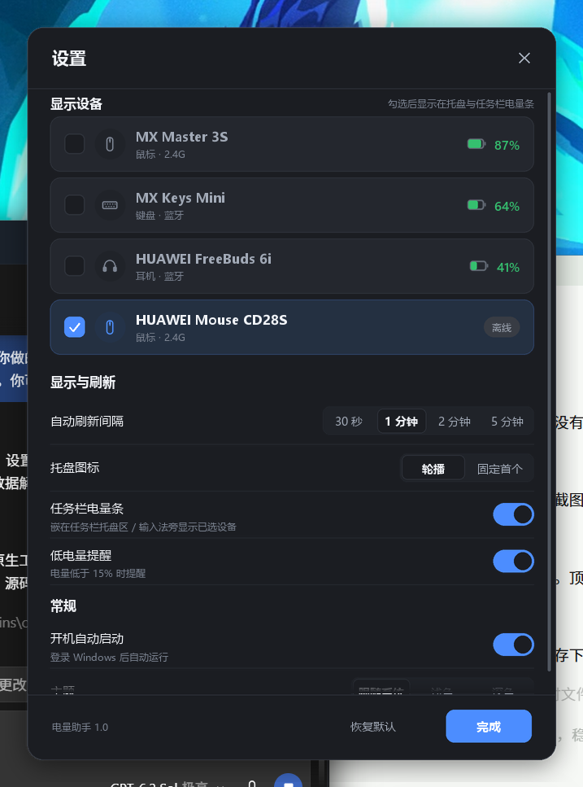
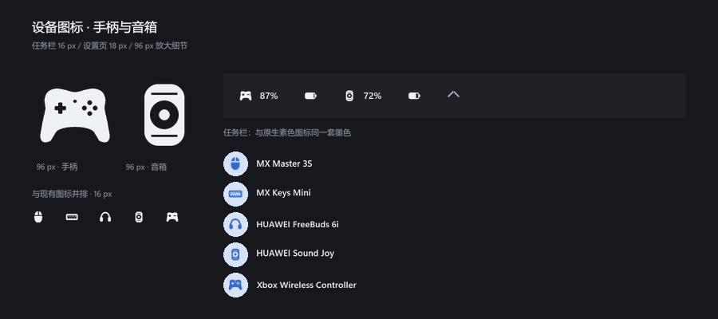

# 电量助手 · TrayBattery

[](https://github.com/SodaPromise/TrayBattery/actions/workflows/tests.yml)
[](LICENSE)
[](requirements.txt)
[](#运行)

在 Windows 任务栏实时显示**蓝牙 / 2.4G 接收器连接的鼠标、键盘、耳机、音箱、手柄电量**。默认只显示鼠标，可在设置里勾选其它设备。

纯 Python + ctypes + Pillow 实现，不装驱动、不依赖厂商管家：一个后台线程按间隔轮询，常驻内存约 45 MB，空闲 CPU 接近 0。

> A tiny Windows tray app that shows battery levels of Bluetooth and 2.4 GHz mice, keyboards and headsets — pure Python, no drivers, no vendor software.


## 功能

- **托盘图标**：电池图标随电量变色（绿 / 橙 / 红），可轮播或固定显示某台设备；悬停显示各设备电量。
- **电量面板**：左键托盘图标开合；显示设备名、连接方式、状态、百分比与电池图标；底部显示更新时间，可「刷新」「设置」。
- **任务栏电量条**（可选）：不是贴一块小广告牌，而是做成任务栏自己的状态项——没有底色和描边，只有图标和数字，直接印在任务栏上；
  墨色按任务栏实际亮度自动取黑或白（强调色 / 浅色 / 毛玻璃都能跟），鼠标移上去才浮出 Windows 那个圆角高亮，右键出菜单；
  可以像原生图标那样在任务栏空白段左右拖动并记住位置，点击开合面板。
- **设置窗口**：勾选显示设备、刷新间隔（30 秒 / 1 / 2 / 5 分钟）、托盘图标模式、任务栏电量条开关、低电量提醒、开机自启、主题（跟随系统 / 浅色 / 深色）。
- **状态区分**：`已连接` / `未连接` / `设备未提供电量接口` / `厂商私有协议，暂未适配` / `读取失败` 分别用不同文案与配色；未连接的设备不再显示实时电量。
- **通用 HID 电池**：按标准 usage 匹配电量字段（`0x06/0x20`、`0x0D/0x3B`、`0x85` 电池系统页），Feature 与 Input 报告都支持，`0–100` 与 `0–255` 量纲自动归一化。
- **已适配的私有协议**：华为 / 荣耀（真机验证）、罗技 HID++ 2.0、Compx 方案（ATK / VXE / VGN / 达尔优 / G-Wolves 等）、雷蛇。
- **低电量提醒**：低于 15%（`config.json` 的 `alert_threshold` 可改）时弹一次气泡通知。
- **自适应**：跟随系统深浅色，Per-Monitor V2 DPI（125% / 150%），多显示器工作区，分辨率变化后自动归位。
- **健壮性**：单实例运行，重复启动会唤起已有窗口；资源管理器重启后自动重新添加托盘图标。

任务栏电量条——只有图标和数字，悬停才出现原生高亮：


多台设备时并排显示：




真实设备（华为接收器，2.4G）：


## 运行

要求：Windows 10 / 11，Python 3.10+，Pillow。

```bash
pip install -r requirements.txt
pythonw TrayBattery.pyw
```

也可以直接双击 `TrayBattery.pyw`（`.pyw` 关联到 pythonw，不弹控制台窗口）。

命令行参数：

| 参数 | 说明 |
| --- | --- |
| `--panel` | 打开电量面板（已有实例时转发给已运行的实例） |
| `--settings` | 打开设置（同样会转发给已运行的实例） |
| `--demo` | 使用演示设备（MX Master 3S / MX Keys Mini / FreeBuds 6i），无需真实设备即可预览界面 |
| `--quit` | 关闭已运行的实例 |

程序只允许一个实例：再次启动不会创建第二份托盘图标，而是唤起已有窗口。

## 首次使用

1. 启动后托盘出现电池图标，默认只勾选**鼠标**。
2. 左键图标查看电量；右键图标打开菜单：

   - 打开电量面板
   - 设备勾选列表（直接勾选要显示的设备）
   - 立即刷新 / 暂停自动刷新
   - 显示任务栏电量条
   - 设置…
   - 开机自动启动
   - 退出

3. Windows 11 默认把新图标放进**溢出区**（任务栏的 `^`）。点开溢出区，把电池图标拖到任务栏上即可常驻；也可以在「设置 → 个性化 → 任务栏 → 其他系统托盘图标」中打开。

## 电量从哪来

| 设备类型 | 数据来源 | 说明 |
| --- | --- | --- |
| 蓝牙耳机 / 音箱 / 手柄 / 部分键鼠 | Windows 蓝牙电量属性（`DEVPKEY_Bluetooth_Battery`） | 需要设备自身通过 HFP/BLE 上报，绝大多数蓝牙耳机支持 |
| 罗技无线键鼠（2.4G 接收器） | 罗技 HID++ 2.0（`0x1004` / `0x1000` / `0x1001`） | 直接和接收器通信，不需要 Logitech Options；遍历接收器 1–6 号设备位 |
| 华为 / 荣耀无线鼠标（星闪或 2.4G 接收器） | 厂商私有 HID 通道（Usage Page `0xFFB3`，数据项 `0x1A`） | 见下方「华为接收器电量协议」，不需要官方驱动；已在真机验证 |
| Compx 方案无线鼠标（ATK / VXE / VGN / 达尔优 / G-Wolves / Zaopin / Scyrox 等） | Compx 公版协议：`0xFF02` 17 字节 / `0xFF05` 64 字节 | 只读查询，按 VID + 鼠标集合命中才执行；协议取自公开开源实现，本机无对应设备未实机验证 |
| 雷蛇无线鼠标（Viper / DeathAdder / Basilisk / Naga / Cobra / Pro Click 等） | 90 字节 Feature Report，命令类 `0x02` / 命令 `0x07` | 按 OpenRazer 公开协议实现，`0x1F` 事务号家族；未实机验证 |
| 标准 HID 外设 | 电量 usage：`0x06/0x20`、`0x0D/0x3B`、`0x85` 电池系统页 | 同时支持 Feature 与 Input 报告；数值按 `LogicalMin/Max` 归一化 |
| 其他品牌的 2.4G 接收器键鼠 | 各家私有协议（未适配） | 显示「厂商私有协议，暂未适配」，可按下方流程补充；报文格式需逐家逆向 |
| 有线 USB 键鼠、无电量上报的设备 | — | 显示「设备未提供电量接口」 |
| 系统里已断开 / 未连接的设备 | 不显示实时电量 | 显示「未连接 / 离线」；`last_level` 只在数据里留档，不会当作当前电量渲染 |

### 设备分类

`infer_kind()` 按设备名分成六类：鼠标 / 键盘 / 耳机 / **音箱** / 手柄 / 设备。
设置页显示对应的中文标签，任务栏与面板按分类画不同图标，排序也按这个顺序。

**音箱是独立一类**（`HUAWEI Sound Joy`、`HUAWEI Sound X`、Bose SoundLink、JBL Flip / Charge、
Sony SRS-X\*、UE BOOM、HomePod、Sonos、Marshall、SoundBar 等）。型号词要放在耳机规则之前判定：
不少品牌同时做耳机和音箱（soundcore、Bose、JBL），只按品牌词会把便携音箱认成耳机；
反过来 `HUAWEI FreeBuds 6i Speakers` 这类音频端点名要留给耳机。
名字里完全无线索时，才按 PnP 类名（`AudioEndpoint` / `MEDIA`）保守归为耳机。

### 连接状态怎么判断

已配对但断开的蓝牙设备，Windows 会一直保留它的 PnP 节点和 `DEVPKEY_Bluetooth_Battery`
属性——里面是**断开前的旧电量**，节点状态甚至仍是 `DN_STARTED`。所以「枚举到节点」
完全不等于「设备连着」：

1. 先用 `DIGCF_PRESENT` 枚举到的**活跃 HID 设备接口**作旁证（按容器 ID / MAC / 产品名匹配）——设备真的连上，系统才会为它建立接口，断开后只剩配对的幽灵节点；
2. 没有活跃接口时再认 `BluetoothFindFirstDevice` 的 `fConnected`（只对经典蓝牙 `BTHENUM` 可靠）。BLE 设备（`BTHLE` / `BTHLEDEVICE`，例如 Xbox 手柄）压根不在这个 API 的枚举结果里，**查不到即视为未连接**；反之若接口确实活跃，即使 classic API 报 `False` 也按在线处理，照顾走 LE 链路的键鼠；
3. 两条路径都拿不到在线证据时一律判为未连接，并清掉实时电量，避免出现「没连手柄却显示已连接 76%」的幽灵读数。只有蓝牙 API 本身不可用时才退回乐观判断。
4. 厂商私有通道（华为 / Compx / 雷蛇）读数失败时最多沿用 30 分钟旧值，超时后按离线处理，
   不会无限期显示最后一次百分比。

> 实现细节：鼠标 / 键盘 / 触控板这类顶层集合会被 Windows 独占，带读写权限 `CreateFileW` 会返回拒绝访问。
> 程序在失败时改用 `dwDesiredAccess = 0` 重新打开，此时仍可读属性与 Feature Report——这是很多标准 HID 电池设备能被读到的前提。

### 华为接收器电量协议

以 `HUAWEI Mouse CD28S`（VID `12D1`、PID `10DB`）为例，接收器在 USB 上暴露 5 个厂商自定义 HID 集合（`0xFFB0`…`0xFFB4`），
其中 `0xFFB3` 是状态/控制通道（64 字节输入 + 64 字节输出，无 Feature Report）。报文首字节固定为 `0x05`：

```
查询电量（主机 → 接收器，64 字节）
  05 1E 00 1A  00 00 ...
              └─ 数据项 0x1A = 电量
应答（接收器 → 主机）
  05 20 00 1A  06  00 00 00 5F 00 00 ...
              └─ 长度 6 └─ 负载[3]=0x5F(95%) 负载[4]=状态
```

状态位：`0` 放电、`1` 充电中、`2` 已充满（统计官方软件日志 300 余次读数得出，`2` 只在 100% 出现）。
另有 `05 00 00 AA …` 心跳帧由接收器每 7 秒主动推送，`05 00 00 F9` 可取型号与固件（ASCII，如 `CD28S 1.0.0.97`）。

因为每次查询都会把无线链路叫醒，程序对这类设备做了 **60 秒缓存**，手动「刷新」时才强制重查。

### 给新的接收器型号加支持

私有协议没有公开文档，做法是「先看通道，再看官方软件怎么问」。仓库里带了几个只读/半只读工具：

```bash
# 0) 一键诊断：接口清单、标准电池字段命中情况、已知私有协议结果
python tools/probe_battery.py
python tools/probe_battery.py 373b        # 只看某个 VID

# 1) 看这个 VID 暴露了哪些 HID 集合、有没有 0xFF00+ 私有页、有没有 Feature Report
python tools/probe_hid.py 046d

# 2) 被动监听 20 秒（不发送任何数据），看哪个通道在主动推帧
python tools/listen_hid.py 20 046d

# 3) 只读探测：试 GetInputReport / GetFeature，确认能否直接取到状态
python tools/probe_read.py 046d

# 4) 按第 3 步得到的通道发一帧并读应答（换掉 FFB3 与报文）
python tools/probe_cmd.py send FFB3 "05 1E 00 1A" --repeat 1
```

如果设备有官方驱动/管家软件，先去看它的通信日志，往往能直接读到协议语义——本项目的华为支持就是这么来的：
`%LOCALAPPDATA%\HUAWEI GoPlay\NeoUsb.log` 里写着 `Dangle model write command 1a` 与 `get power value 95`。

拿到报文后，在 `app/providers.py` 里照 `scan_compx()` / `scan_razer()` 的写法加一个 `scan_xxx()`，
在 `discover()` 的 `vendor_battery` 里合入即可（返回 `{容器 ID: (电量, 是否充电)}`）。

### 已知的公开协议（可直接抄）

**Compx / Nordic 52840**（ATK、VXE、VGN、达尔优、G-Wolves、Zaopin、Scyrox 等共用）：

```
写  08 04 00 00 00 00 00 00 00 00 00 00 00 00 00 00 49     ← 17 字节，整帧和为 0x55
读  08 04 00 00 00 02 23 00 0e 94 00 00 00 00 00 00 82
           └状态    └35%  └有线标志  └ 3732 mV
```

**Nordic 54L15**（ATK Zero 等新款）：`08 7D 72 02 00 01 07 01`，64 字节；回复 `[1]=0x72`、`[5]=0x07`、电量在 `[7]`。

**雷蛇**：Feature Report 90 字节，`00 1F 00 00 00 02 07 80` + 80 字节数据 + XOR 校验 + 0，
回复第 `[9]` 字节为 0–255 的电量（含 report id 时是 `[10]`），无线鼠标需等待约 300 ms 才有应答。

**罗技**：HID++ 2.0，`0x1004` 统一电量 → `0x1000` 电量状态 → `0x1001` 电压估算。

协议来源：`Fan4Metal/mouse_tray`、`yszyszysz233/2.4G-battery-viewer`、OpenRazer。若要新增型号，
多数情况只需把 VID/PID 加进对应列表（`COMPX_VIDS` / `RAZER_PIDS`），报文本身不用改。

## 测试

```bash
# 单元测试：数据模型、配置读写、协议工具函数、绘制
python -m unittest discover -s tests -v

# 功能冒烟：用 demo 数据启动完整应用，操作托盘/面板/任务栏电量条/设置后退出
python tools/smoke.py
```

冒烟测试会把配置重定向到临时目录、跳过注册表操作，不会影响正在使用的配置；运行时会短暂弹出窗口（约 5 秒）。
GitHub Actions 会在 Windows + Python 3.10 / 3.12 上跑单元测试（见 `.github/workflows/tests.yml`）。

当前覆盖：32 个单元测试 + 69 项界面交互检查，包含首次启动默认只显示鼠标、演示数据含独立音箱分类、电量条嵌入任务栏且位于托盘区左侧、面板定位不越界且停在任务栏上方、
电量条无底色（透明面积占比）、悬停高亮不顶到任务栏边缘、拖动范围夹取与位置记忆、设备增减后重新贴住托盘、设置滚动与点击、主题切换、暂停/恢复刷新等。
单元测试另含连接判定回归：已配对但未连接的 BLE 手柄必须判离线且不显示旧电量，而 API 报告已连接或存在活跃 HID 接口时仍要正常显示百分比；
以及设备分类（音箱 / 耳机 / 手柄互不误判）、五种图标绘制和手柄轮廓「从上到下张开」的形状断言。

## 配置与日志

- 配置：`%APPDATA%\TrayBattery\config.json`（原子写入，损坏时回落到默认值）
- 日志：`%APPDATA%\TrayBattery\app.log`（异常堆栈会写在这里，便于排查）

删除配置目录即可恢复出厂状态。

## 常见问题

**面板显示「1 台设备」但只有鼠标？**
默认只显示鼠标。打开设置勾选其它设备，或在托盘右键菜单里直接勾选。

**耳机一直显示「离线」？**
设备在系统里没有连接。连上后等一轮刷新（或点「立即刷新」）即可。若系统蓝牙里显示已连接但仍离线，检查是否被其它设备（手机）抢占连接。

**手柄明明没连，之前却显示「已连接 76%」？**
Windows 会保留已配对设备的 PnP 节点和断开前的电量属性，早期版本把「蓝牙 API 查不到这台设备」误解成「已连接」，于是 BLE 手柄（Xbox 等 `BTHLE` 设备）会带着旧电量一直显示在线。现在只有拿到明确的在线证据才会显示百分比，详见上文「连接状态怎么判断」。反过来，若设备刚连上、状态还没跟上，点「立即刷新」即可。

**电量不更新？**
先确认没有「暂停自动刷新」；部分设备只在电量变化时上报，读数会滞后。华为接收器有 60 秒缓存，点「刷新」可立即重查。

**华为鼠标显示「不支持电量读取 / 接收器未应答」？**
说明厂商通道没被识别：确认接收器是插着的（设备管理器里 `VID_12D1&PID_10DB`），并且没有别的软件独占它。
本程序按「VID = `12D1` 且存在 Usage Page `0xFFB3` 集合」识别，其它型号的华为/荣耀鼠标若用量页不同，需要按上文协议补一条规则。
和官方「华为/荣耀电脑管家」的鼠标工具（GoPlay）同时运行没有问题，两者都能读。

**为什么我的鼠标能被官方软件读到，别的工具读不到？**
厂商把电量放在私有 HID 通道里，只有知道数据项编号才读得到（例如华为用 `0x1A`）。
本程序的做法是抓官方软件的通信日志、再用同样的报文验证，因此不依赖官方驱动，也不会修改设备设置。

**任务栏图标突然不见了？**
资源管理器重启会清空通知区域，程序收到 `TaskbarCreated` 广播后会自动重新添加。若仍不见，检查是否被收进了溢出区。

**怎么彻底退出？**
托盘右键 →「退出」，或执行 `python TrayBattery.pyw --quit`。程序不会在后台残留进程。

**开机自启在哪关闭？**
设置 → 常规 → 开机自动启动，或托盘右键取消勾选（写入 `HKCU\Software\Microsoft\Windows\CurrentVersion\Run`）。

## 已知限制

- 只支持 Windows 10 / 11；界面依赖 Win32 分层窗口，无跨平台计划。
- **不能真的插进资源管理器的托盘图标队列**：Win11 的托盘图标由 explorer 的 XAML 私有渲染，第三方窗口只能贴在托盘区左侧的空白段上。
  所以「和别的图标交换位置」是这样实现的：电量条可以在任务栏空白段上左右拖动、记住位置，但不会让系统图标给它让位。
  另外从 Windows 11 起，任务栏和托盘图标本来就不支持拖动排序了（那是 Win10 的行为），
  系统图标的顺序只能在「设置 → 个性化 → 任务栏 → 其他系统托盘图标」里改。
- 竖排任务栏（任务栏放在屏幕左右侧）不做嵌入，退回成一个小悬浮条。
- 私有协议只覆盖上表列出的厂商。其余 2.4G 设备会明确显示「厂商私有协议，暂未适配」，不会误报电量。
- 2.4G 接收器休眠时需要先唤醒，首次查询可能耗时 1 秒左右；因此私有协议默认缓存 60 秒。
- 蓝牙电量完全取决于设备是否通过系统属性上报，部分老设备只有 HFP 通道，Windows 不暴露数值。

## 目录结构

```
TrayBattery/
├─ TrayBattery.pyw        入口（pythonw 无控制台启动）
├─ app/
│  ├─ main.py             App 主体：状态聚合、托盘菜单、窗口位置、设置联动
│  ├─ win32.py            ctypes 封装：分层窗口、消息循环、图标、DPI、工作区
│  ├─ devapi.py           SetupAPI / HID 设备枚举与 Feature Report 读写
│  ├─ providers.py        设备发现：蓝牙电量、罗技 HID++、华为、Compx、雷蛇、标准 HID
│  ├─ monitor.py          后台轮询线程（Event 唤醒，按间隔取数）
│  ├─ model.py            Device / AppState 数据模型与状态文案
│  ├─ draw.py             Pillow 绘制：画布、电池图标、设备图标、应用标识
│  ├─ theme.py            浅色/深色主题、字体、任务栏墨色采样
│  ├─ config.py           配置读写、设备记忆
│  ├─ startup.py          开机自启（HKCU Run）
│  ├─ log.py              日志
│  ├─ tray.py             托盘图标、隐藏消息窗口、资源管理器重启恢复
│  └─ ui/
│     ├─ base.py          分层窗口基类、命中测试、拖拽、淡入、通用控件
│     ├─ flyout.py        电量面板
│     ├─ settings.py      设置窗口（可滚动）
│     └─ bar.py           任务栏电量条（Shell_TrayWnd 子窗口，原生墨色 + 可拖动）
├─ assets/                图标与截图
├─ tests/test_core.py     单元测试
├─ tools/
│  ├─ smoke.py            功能冒烟（demo 实例 + 界面交互）
│  ├─ shots.py            抓任务栏截图（README 用）
│  ├─ probe_battery.py    一键诊断
│  ├─ probe_hid.py        打印 HID 接口、用量页与报告描述符
│  ├─ probe_read.py       只读探测 GetInputReport / GetFeature
│  ├─ listen_hid.py       被动监听厂商集合的输入报文
│  ├─ probe_cmd.py        向指定用量页发一帧并打印应答（协议验证用）
│  └─ make_icon.py        由绘制代码生成多尺寸 icon.ico / icon.png
└─ .github/workflows/    CI（Windows + unittest）
```

## 实现要点

- **无边框自绘**：所有界面都是 `WS_EX_LAYERED | WS_EX_TOOLWINDOW | WS_EX_TOPMOST | WS_EX_NOACTIVATE` 的分层窗口，用 `UpdateLayeredWindow` 直接推 32 位位图，因此可以做到圆角、阴影、半透明而不触发窗口重绘闪烁。
- **清晰度**：按逻辑坐标设计（如 344×192），乘以 DPI 缩放得到物理像素后在 2× 超采样画布上绘制形状，再 LANCZOS 降采样。
- **文字渲染**：文字不走画布的 2× 画布，而是单独按 **3× 超采样**绘制再降采样——小字号直接栅格化时，FreeType 会让横竖笔画粗细不匀（中文尤其明显），
  3 倍超采样把边缘摊到更多灰阶上才够细腻。字重取自 `SegUIVar.ttf` 的可变字重轴（Semibold / Regular），
  并用紧贴墨迹的 `getbbox()` 结果校正锚点，所以 `lm`/`mm` 是"墨迹居中"而不是"字体基线居中"，文字不会看着偏高或偏左。
  标题加 0.3 的正字距显得透气，任务栏百分比用 -0.2 的负字距，数字才不会散开。
  渲染结果按 `(字体, 字号, 颜色, 文字, 字距)` 做 LRU 缓存，滚动时不重复排版。
- **中英分流**：同一句话里按字符切段——汉字、假名、全角标点走微软雅黑（`Microsoft YaHei UI`），
  拉丁字母和数字走 `Segoe UI Variable` 的对应字重实例，两段共用一条基线。
  整段都用雅黑是最省事的做法，但雅黑自带的拉丁字形偏宽、x 高度偏大，
  和系统原生界面（正文一直是 Segoe UI）摆在一起，"MX Master 3S" 这种设备名会明显不像这个系统的字。
  宽度测量（`text_width`）走同一套分流规则，否则英文字符串会被按雅黑宽度提前截断。
- **正确的 alpha**：`UpdateLayeredWindow` 要的是预乘 alpha，直接把 RGBA 推上去会让半透明像素偏亮（文字描边发白、6% 的悬停底变成实心白块）。
  现在统一先转 `RGBa` 再上传，悬停高亮、抗锯齿边缘才是对的。
- **任务栏墨色**：任务栏可能是深色、浅色、强调色或毛玻璃，读注册表不如直接 `ImageGrab` 采样电量条左侧那一小条任务栏的平均亮度（2 秒缓存），
  低于 150 用白墨，否则用近黑；低于 10% 才换成系统的告警红。
- **可点也可穿**：分层窗口按 alpha 做命中测试，全透明的地方点不到。所以电量条在任务栏上垫了一层 alpha=1 的底（肉眼不可见），
  整条都能接鼠标，悬停高亮才浮得出来；这块底就只有电量条那么大，不会挡住任务栏别的东西。
- **低占用**：后台线程 `Event.wait(interval)` 睡眠，UI 线程只在有数据时重绘；托盘图标位图缓存在内存里，仅在电量变化时重建。
- **滚动不卡**：设置页拆成三层缓存——静态底图（圆角、阴影、页眉页脚）只在尺寸变化时重画一次，滚动内容单独成图，
  上下渐隐带再叠一层，滚轮只更新目标位置。每帧只做一次裁剪合成，实测 8 ms 左右；
  滚动位置用指数缓动逐帧逼近目标值（`SetTimer` 16 ms 一帧），末段不足 1 px 才吸附停帧，所以是"滑"过去而不是一档一档跳。
  每次 `render()` 都按当前 `scroll` 重新注册 `set_hits()` 的命中区域（固定按钮 + 裁到可视区的滚动控件），
  滚动后点击才不会失灵——只在开局注册一次，所有按钮滚完就都点不动了。
  阴影也只模糊设备行那一小块矩形，早期版本整画布高斯模糊要 40 ms。
- **一次枚举**：每轮刷新只枚举一次 HID 接口（37 个接口约 24 ms），厂商私有协议共用这次结果；私有读取带 60 秒 TTL，常规一轮约 130 ms，手动刷新才强制唤醒设备。

## 图标

设备图标（鼠标 / 键盘 / 耳机 / 音箱 / 手柄）由 `app/draw.py` 的 `device_glyph()` 直接画，不依赖图标字体，
先按 4 倍尺寸绘制再 LANCZOS 降采样，所以 16 px 下边缘也是平滑的。
鼠标用的是超椭圆轮廓（指数 2.4、前端收窄 8%），机身 0.60×0.87——按真鼠标的 1:1.6 会瘦成一根胶囊，
略宽一点才能和旁边扁平的键盘图标配得上；再靠一道横缝分出左右按键、一道竖缝当滚轮分界。
鼠标统一画**实心剪影再挖缝**：描边版在 16–18 px 下只剩一圈细线，摆到键盘、耳机旁边会明显单薄一截，
挖空出来的缝反而更像系统自带的状态图标。

音箱画的是便携圆柱音箱的正面：竖向机身实心剪影，中间挖出喇叭单元的圆环，
上下两道短缝暗示端盖分界；沿用鼠标/手柄的「实心剪影 + 挖空」，16 px 下才不会比键盘、耳机单薄。

手柄沿用同一套「实心剪影 + 挖空按键」：轮廓由 Catmull-Rom 把 15 个控制点插值成平滑闭合曲线。
**两侧从上到下向外张开**——肩线在上方最宽处约 0.92，往下不内收，握把外缘一路外撇到 0.98 再圆钝收口，
底部中央凹口刻意做浅，16 px 下才不会看成字母 M；左侧挖十字键，右侧挖 ABXY 四颗面键和中间的菜单键。
任务栏的 16 px 会自动简化成「十字键 + 两点」，否则四颗面键会糊成一团灰；18 px 及以上保留完整造型。
`infer_kind()` 按设备名识别 Xbox / DualSense / Switch Pro 等手柄，
但不会把名字里只有 "controller" 的音频、MIDI 控制器误判成手柄。



改了图标造型后，重跑 `python tools/make_gamepad_preview.py` 可重新生成上面这张展示图。

`assets/icon.ico`（16–256 多尺寸）由绘制代码生成，改颜色或形状后重新生成：

```bash
python tools/make_icon.py
```

给快捷方式换图标：右键 `TrayBattery.pyw` → 发送到 → 桌面快捷方式 → 属性 → 更改图标 → 选择 `assets/icon.ico`。

## 许可

[MIT](LICENSE)
